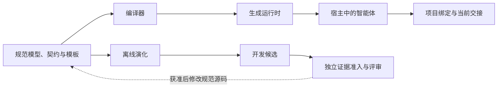

# 模块导航

当前候选：**3.0.0-rc.20.5**。版本与发布状态见[当前项目状态](PROJECT_STATE.md)。

## 按改动目标定位

| 改动目标 | 源码入口 | 契约与消费者 | 验证入口 | 影响边界 |
|---|---|---|---|---|
| 规则、风险、局部或结构模式 | [治理模型](governance-src/model/governance-model.json)、[规划器](governance-src/runtime-scripts/plan_governance.py) | [任务输入](governance-src/schemas/task-context.schema.json) → [治理计划](governance-src/schemas/governance-plan.schema.json)；[可选项目提示](governance-src/profiles/) | [规则检查](tools/governance_lint.py)、[规划与运行时测试](tests/test_compiled_runtime.py)、[按需工作流测试](tests/test_operational_guidance.py) | 计划投影命中的原闭包及工作流块；完整 Skill 常驻，未知项目提示仍用通用规则 |
| 安装、绑定、完成、导出或卸载 | [仓库命令入口](upg.py) → [生命周期](governance-src/runtime-scripts/project_tool.py) | [执行记录](governance-src/schemas/execution.schema.json)、[灰测报告](governance-src/schemas/field-report.schema.json)；[资格运行器](qualification/lib/execution.py) | [生命周期测试](tests/test_compiled_runtime.py)、[完成结果测试](tests/test_completion_outcomes.py) | 绑定与既有工作流；保留已启用的报告状态和原始开始事实 |
| 自动 Git 阶段提交、去重或恢复 | [生命周期](governance-src/runtime-scripts/project_tool.py) → [Git 检查点](governance-src/runtime-scripts/git_checkpoint.py)、[观察器](governance-src/runtime-scripts/git_watch.py)、[进程锁](governance-src/runtime-scripts/process_guard.py) | [配置与行为契约](docs/git-checkpoints.md)；绑定内有界配置与恢复状态，复用工作流 begin/finish | [Git 检查点测试](tests/test_git_checkpoints.py)、[完成结果测试](tests/test_completion_outcomes.py) | 显式启用与允许范围；冷却、完成或显式交接/风险收束、噪声与重复排除；前台实际项目会话绑定，退出即停／会话内监督恢复；无可靠结束信号时有限执行；不注册系统启动项、无模型调用或自动 push |
| 状态校验、验证引用或交接 | [状态工具](governance-src/runtime-scripts/state_tool.py) | [执行记录](governance-src/schemas/execution.schema.json) → [交接记录](governance-src/schemas/handoff.schema.json)；生命周期与后续接手者 | [验证连续性测试](tests/test_validation_continuity.py)、[证据连续性测试](tests/test_rc9_evidence_continuity.py) | 按范围、运行标识和已测修订核对证据；后续改动保留待重测状态 |
| 中断恢复、过期索引或源码矛盾 | [事实恢复](governance-src/runtime-scripts/project_facts.py) ← [状态工具](governance-src/runtime-scripts/state_tool.py) | 显式文件范围、[交接契约](governance-src/schemas/handoff.schema.json)；[恢复说明](docs/project-fact-recovery.md) | [恢复测试](tests/test_project_recovery.py)、[真实工具恢复契约测试](tests/test_fact_recovery_tools.py) | 有界静态读取；未知意图、动态行为和未覆盖范围保持未知 |
| 指令表达、生成或完整性 | [指令模板](governance-src/templates/)、[编译器](compiler/compile_governance.py)、[完整性工具源码](governance-src/runtime-scripts/validate_integrity.py) | [治理源码职责](governance-src/README.md#规范职责) → [生成包](universal-project-governance/) | [编译与运行时测试](tests/test_compiled_runtime.py)、[全局指令投影测试](tests/test_context_discipline.py)、[包校验](tools/validate_skill_bundle.py) | 只改规范源码后生成；语义、编译或包字节变化影响运行时及资格身份 |
| 离线反思、搜索、预算或检查点 | [控制器](evolution/controller.py)、[反思](evolution/reflective.py)、[源码桥](evolution/source_bridge.py) | [离线契约](evolution/contracts.py)、[开发协议](evolution/protocol/)；[评估器](evolution/evaluator.py)与[消融](evolution/ablation.py) | [控制器测试](tests/test_evolution_controller.py)、[预算测试](tests/test_evolution_selection_budget.py)、[检查点测试](tests/test_evolution_checkpoint_io.py) | 仅仓库内候选；[独立准入](evolution/promotion.py)决定提案资格，不能直接改已安装包 |
| 原生文件产物测量 | [原生适配器](evolution/native_codex.py)、[产物评分](evolution/task_benchmark.py) | 注册配置、源码与评分身份；[原生测量说明](docs/offline-evolution.md#native-cli-development-adapter) | [适配器测试](tests/test_evolution_native.py)、[产物评分测试](tests/test_evolution_task_benchmark.py)、[费用留存测试](tests/test_native_cost_persistence.py) | 评估返回产物；完成回合用量不等于提供方内部全部尝试费用 |
| 真实文件／Git 工具、收据或传输 | [工具适配器](evolution/tool_codex.py)、[工具代理](evolution/tool_broker.py)、[传输配置](evolution/cli_transport.py) | 工具代理中的任务契约与固定正向检查；[工具传输说明](docs/rc19-tool-transport.md) | [工具测试](tests/test_evolution_tools.py)、[字节收据测试](tests/test_tool_patch_receipts.py) | 默认只解析提交源码；注册文件与有界工具不变，有限 CPython 须显式选择 |
| 有限行为、文档与任务契约 | [纯解释器](evolution/semantic_contract.py) → [工具代理](evolution/tool_broker.py)；[可选 CPython 后端](evolution/isolated_python.py)、[任务工厂](evolution/experiments/context_tasks.py) | [公开子语言、文档与边界](docs/rc20-behavior-contracts.md)；文档链接复用[导航解析器](tools/validate_navigation.py)；历史 AST 检查保留 | [解释器测试](tests/test_semantic_contract.py)、[代理集成测试](tests/test_semantic_broker.py)、[后端纯测试](tests/test_isolated_python.py)、[任务契约测试](tests/test_context_task_definitions.py) | Python 3.10+；默认 VM，显式后端仍保留完整 VM 和主机精确比较；文档事实另审，不证明完整应用或全部宿主安全 |
| 官方 API 工具循环与类型化终态 | [仓库 API 适配器](evolution/provider_tools.py)、[显式 SSE 重建](evolution/chat_sse.py)、[检查点准入](evolution/actor_checkpoint.py) → [工具代理](evolution/tool_broker.py) | [终态 schema](evolution/tool_codex.py)；[原生结束与诊断边界](docs/rc20-behavior-contracts.md)；调用方冻结任务、推理配置、预算和凭据回调 | [API 工具契约测试](tests/test_provider_tools.py)、[阶段中断测试](tests/test_provider_tools_phase.py)、[SSE 边界测试](tests/test_provider_tools_sse.py) | 仅仓库实验；路径清单不代替读取，结束工具不代替读写；兼容与显式推理配置分开，未知用量保留；显式恢复累计旧请求、工具与时间预算，保留原失败身份 |
| 标准库 Python 工程执行 | [工程代理](evolution/engineering_broker.py) → [执行器](evolution/project_executor.py)；[纯收据重放](evolution/native_cli_receipts.py)只分类独立证据 | [工程配置边界](docs/rc20-behavior-contracts.md#显式标准库-python-工程配置)；冻结测试 ID、CLI 输入输出及当前字节收据；匿名公开验证事实区分检查组与实际测试数 | [工程 API](tests/test_engineering_provider.py)、[工程 CLI](tests/test_engineering_cli.py)、[准备收据](tests/test_cli_preparation_evidence.py)、[执行器](tests/test_project_executor.py)、[工作截止与结算](tests/test_managed_settlement.py)、[当前验证分类](tests/test_native_cli_receipts.py)测试 | 显式新身份；固定配方、已知失败可修复、未知停止、终态纯读收据；CLI 内部请求覆盖不等于 API，未证明任意项目安全 |
| 真实工具实验、配对分析或费用 | [实验收集与分析](evolution/tool_campaign.py) | [实验协议](evolution/protocol/) → 工具适配器；[既有独立结果](docs/rc19-tools-independent-v13.md) | [实验测试](tests/test_tool_campaign.py) | 现有收集器严格限定两条件；未知调用保留围栏，不能自动重放或算作零费用 |
| 九族开发配对、阶段接手及盲审分析 | [冻结开发驱动](qualification/pilots/rc20-primary/README.md) → 目录内的 prepare/run_once/audit_once/manual/analyze | [源码身份](qualification/pilots/rc20-primary/source-manifest.json)、固定 v8 标准；当前运行事实由 [PROJECT_STATE](PROJECT_STATE.md) 维护 | 独立源码闭环、调用前注册、首次原始独审、全量初始盲审锁定及固定分析 | 仅仓库实验；冻结依赖为复现快照，README 中状态为封存时点；不随 Skill 交付、不构成晋升 |
| 正式资格、执行身份或冻结 | [资格契约](qualification/lib/contracts.py)、[注册与证据](qualification/lib/core.py)、[执行](qualification/lib/execution.py) | [资格协议](qualification/protocol/qualification-v3.json)、[适配器契约](qualification/adapters/adapter.schema.json)；[资格说明](qualification/README.md#reproducible-execution-identity) | [资格测试](tests/test_qualification.py)、[资格校验](tools/validate_qualification.py)、[冻结工具](tools/qualification_freeze.py) | 冻结结果轮开始后不改冻结面；开发证据不能升级为正式资格 |
| 评分、门禁、越界或隐私 | [分析门禁](qualification/analysis/gates.py)、[盲评](qualification/graders/blind_pair.py)、[诊断脱敏](qualification/adapters/diagnostics.py) | 资格协议、场景范围与正向产物契约；[结构越界说明](qualification/README.md#structural-overreach) | [误判测试](tests/test_qualification_false_positives.py)、[资格测试](tests/test_qualification.py)、[安全审计](tools/security_audit.py)及[扫描边界测试](tests/test_security_scan.py) | 修复评分缺陷需合法结果与反例；关键安全和越界失败不能由成功率抵消 |
| 文档导航、仓库校验或发布打包 | [导航校验](tools/validate_navigation.py)、[仓库校验](tools/validate_repository.py)、[打包](tools/package_release.py) | [贡献流程](CONTRIBUTING.md)、[发布流程](PUBLISHING.md)、[持续集成](.github/workflows/validate.yml) | [导航测试](tests/test_navigation.py)、[包测试](tests/test_compiled_runtime.py) | 导航只校验链接目标；不证明语义、行为或发布门禁通过 |

## Skill 与计划的边界

Skill 保留全部全局义务；plan 是任务投影，按原 policy 闭包和已解析报告/现有 reporting 状态选取 `operational_guidance`，每块只出现一次。无 helper 仍使用完整 Skill 与手工 index 路由，非平凡工作不得因上下文漏报跳过工作流。旧六条件收集器 [context_campaign](evolution/context_campaign.py) 保留原 inline 契约及[旧实验测试](tests/test_context_campaign.py)，不用于新路由。 新真实工程对照的六条件、路由、预算和角色身份统一来自 [engineering_study](evolution/engineering_study.py)，由[拓扑与真实 RC19 差异测试](tests/test_engineering_study.py)约束；纯元数据通过不授予模型执行或收益结论。来源、未知费用和独立证据范围见[选择性映射](docs/upstream-rule-map.md)。

## 公共接口改动

接口或状态格式变化时，从上表契约追到生产者、读取者、仓库命令、适配器和测试；再用实际符号或字段搜索确认消费者。静态入口不能枚举动态调用，发现范围外消费者时保留兼容性结论的限制。结构模式仍受当前任务边界约束，见[源码结构规则](governance-src/README.md#结构范围)。

## 中断后恢复

接手者先核对[当前状态](PROJECT_STATE.md)、[仓库约定](AGENTS.md)、实际工作树差异、已有验证与项目内当前交接，再按上表读取受影响源码和契约。索引、说明或交接与源码冲突时，以当前源码及可核实证据重建事实；摘要和哈希不能证明行为正确。恢复使用既有交接，不另建历史或验证账本。

## 状态与历史

[使用入口](README.md) · [决策](DECISIONS.md) · [变更记录](CHANGELOG.md) · [历史审计](audits/) · [许可与来源](third_party/notices/README.md)。历史记录保留原来的数字、引用和证据范围，不能据此推断当前收益或资格已成立。

